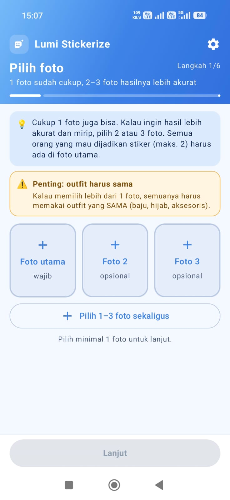
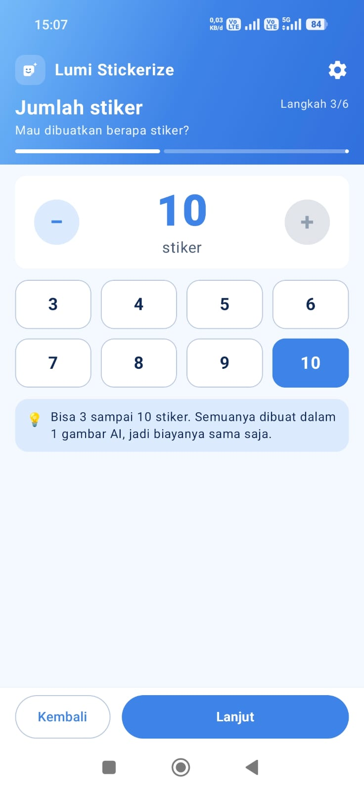
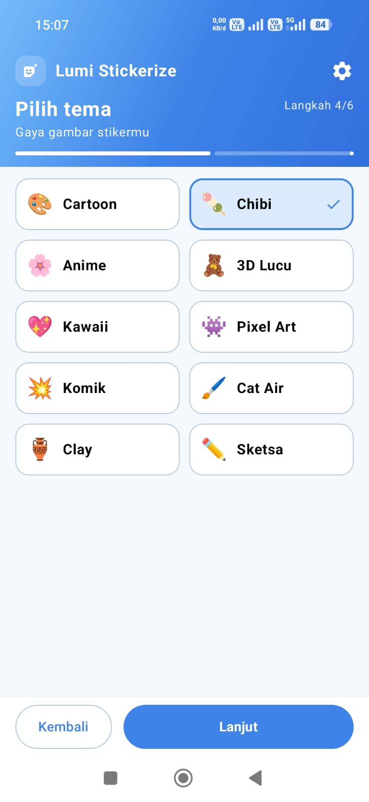
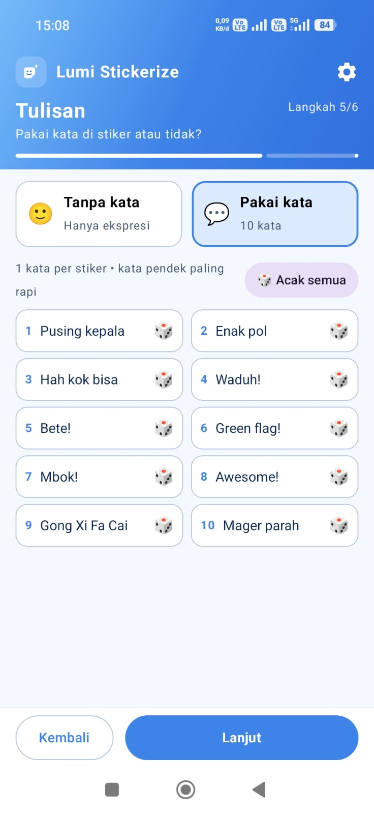

<div align="center">

# ✦ Lumi Stickerize ✦

### Pembuat stiker WhatsApp otomatis dengan AI untuk Android

*1–3 foto · 1 gambar AI · 3–10 stiker · 20 paket tema · 2.000 kata & pose · langsung masuk WhatsApp*

[](https://github.com/vickyvam72/LumiStickerize/releases/latest)
[](#-kebutuhan-sistem)
[](#%EF%B8%8F-teknologi)
[](#-fitur)
[](LICENSE)

**🌐 Bahasa / Language:** &nbsp; **🇮🇩 Bahasa Indonesia** &nbsp;|&nbsp; [🇬🇧 English](README.en.md)

[⬇️ Unduh](#%EF%B8%8F-unduh--pasang) · [✨ Fitur](#-fitur) · [📖 Panduan](#-panduan-pemakaian) · [❓ FAQ](#-faq--mengatasi-masalah) · [📝 Catatan Perubahan](CHANGELOG.md)

</div>

---

## 🌟 Kenapa Lumi Stickerize?

> Pilih 1 sampai 3 foto, tentukan tema dan kata-katanya, lalu **Lumi Stickerize** membuatkan satu paket stiker WhatsApp yang mirip denganmu, sudah dipotong rapi dan siap dipakai dalam **sekali tekan**.

| | |
|---|---|
| 🤖 **Stiker mirip kamu** | AI mempelajari wajah, rambut atau hijab, dan outfit dari fotomu. 1 foto cukup, 2–3 foto lebih akurat. |
| 💑 **Bisa berdua** | Deteksi wajah otomatis. Pilih 1 orang, atau 2 orang sekaligus untuk **stiker couple**. |
| 💸 **Hemat token** | Semua stiker digambar dalam **1 gambar saja**, jadi biaya 3 atau 10 stiker sama. |
| ✂️ **Potong otomatis** | Latar dihapus, bingkai dan garis sisa dibuang, lalu tiap stiker diberi garis tepi putih. |
| 🎨 **20 gaya gambar** | Cartoon, Chibi, Anime, 3D Lucu, Kawaii, Pixel Art, Komik, Cat Air, Clay, Sketsa, Karikatur, Flat Vektor, Line Art, Pop Art, Retro 90-an, Krayon, Neon, Lukisan Minyak, Rajut, dan Kertas. |
| 🎁 **20 paket tema** | Tema yang paling sering dipakai: Sapaan, Bucin, Ngakak, Kantor, Jomblo, Jualan online, dan lainnya. Tiap tema berisi **100 kata & pose**, terisi acak sekali ketuk. |
| 💬 **1.600+ kata siap pakai** | Tulis sendiri, atau tekan 🎲 untuk kata acak di tiap stiker. |
| 📦 **Paket saya** | Lihat isi paket, ganti nama, hapus stiker atau paket, dan simpan ke Galeri. |
| 🧽 **Penghapus manual** | Masih ada bagian yang kurang rapi? Gosok saja dengan jari. |
| 🆓 **Ada opsi gratis** | Pakai model gratis harian dari Cloudflare, atau model OpenRouter untuk hasil terbaik. |

---

## 📸 Tampilan

> Dari foto biasa jadi **satu paket stiker WhatsApp** dalam beberapa ketukan. Tiap langkah muat dalam **satu layar**, tanpa scroll dan tanpa ribet.

<div align="center">

| 📷 **1 · Pilih foto** | 🔢 **3 · Jumlah stiker** |
|:-:|:-:|
|  |  |
| **Satu foto pun jadi.**<br>Tambah foto 2 & 3 biar AI makin kenal wajahmu. | **Mau 3 atau 10, biayanya sama.**<br>Semua stiker digambar dalam 1 gambar AI. |

| 🎨 **4 · Pilih tema** | 💬 **5 · Tulisan** |
|:-:|:-:|
|  |  |
| **20 gaya, satu wajah.**<br>Dari Chibi yang gemas sampai Sketsa yang estetik. | **Kehabisan kata? Lempar dadu 🎲**<br>1.647 kata siap pakai, dari salam sampai bahasa gaul. |

</div>

---

## ✨ Fitur

**🖼️ Foto & wajah**
- **1 foto sudah cukup**; tambah foto 2 dan 3 (opsional) agar hasil lebih akurat
- Pilih foto satu per satu atau **sekaligus**
- Peringatan di awal: kalau memakai lebih dari 1 foto, semuanya harus memakai **outfit yang sama**
- **Deteksi wajah otomatis** di foto utama (berjalan di HP, tanpa internet)
- Ketuk kotak di wajah untuk memilih, **maksimal 2 orang**
- Wajah yang tidak dipilih **disamarkan** sebelum dikirim ke AI

**🎨 Pengaturan stiker**
- Jumlah stiker **3 sampai 10** (minimal 3 sesuai aturan WhatsApp)
- **20 gaya gambar**, semuanya muat dalam satu layar
- **Tanpa kata** (hanya ekspresi) atau **pakai kata**, satu kata per stiker
- Tombol 🎲 di tiap kolom dan **🎲 Acak semua**, dari **1.647 kata** dalam 33 kategori: salam, terima kasih, maaf, tertawa, bucin, kerja, sekolah, makan, Islami, bahasa gaul, bahasa daerah, dan lainnya
- **+ pose (opsional)** di tiap kata: tulis sendiri gaya stikernya (mis. "menutup hidung") atau pilih dari ide cepat, cocok untuk kata yang tidak umum
- **🎁 20 paket tema siap pakai**, masing-masing berisi **100 kata & pose** (total 2.000): Sapaan harian, Makasih & maaf, Reaksi chat, Ngakak, Bucin, Galau, Kesel & ngegas, Mager, Kantor, Sekolah & kuliah, Kulineran, Sahabat, Grup keluarga, Gajian & bokek, Ngopi & nongkrong, Jomblo, Ulang tahun, Selamat ya!, Semangat, Jualan online. Sekali ketuk, kata dan pose terisi **acak** dari tema itu; ketuk lagi untuk kombinasi lain, atau tekan 🎲 untuk mengganti satu stiker saja. Daftar tema cukup emoji dan judul, muat satu layar

**✂️ Hasil**
- Stiker 512×512 WebP di bawah 100 KB, sesuai syarat WhatsApp
- Otomatis membuang latar putih, **kotak/bingkai**, **potongan garis**, dan bintik
- **Rapikan stiker**: penghapus dengan ukuran kuas, Urungkan, dan Ulang dari awal
- Lihat gambar asli dari AI untuk membandingkan
- **Ganti sebagian**: centang 1 atau beberapa stiker, lalu **ubah kata & pose**-nya atau **buat ulang** hanya stiker itu, tanpa membuat ulang semuanya
- **Buat ulang semua** dengan pengaturan yang sama
- **⬇ Simpan ke Galeri** sebagai PNG transparan (folder *Pictures/Lumi Stickerize*), untuk dipakai di Instagram Story, Telegram, dan lainnya

**🔔 Tinggal saja, nanti diberi tahu**
- Selama AI bekerja, kamu boleh pindah aplikasi atau mematikan layar
- **Notifikasi** muncul saat stiker sudah jadi (atau kalau gagal)
- Kalau AI menggambar **lebih sedikit** stiker dari yang diminta (mis. 8 dari 10), tekan **➕ Lengkapi** untuk membuat **hanya stiker yang kurang**, dengan gaya yang senada
- **Pesan error yang jelas** beserta tombol yang tepat: saldo habis → *Isi saldo*, key salah atau kuota habis → *Buka Pengaturan*, internet putus atau AI sibuk → *Coba lagi*

**📲 Tambahkan ke WhatsApp**
- Tombol **Tambahkan ke WhatsApp** resmi, mendukung WhatsApp dan WhatsApp Business
- Simpan ke **paket baru** atau **tambahkan ke paket yang sudah ada** (maks. 30 stiker per paket)
- Nama paket bisa diganti
- Stiker yang diedit setelah ditambahkan ikut diperbarui di WhatsApp
- **📦 Paket saya**: lihat semua paket, ganti nama, hapus beberapa stiker, hapus paket, tambahkan lagi ke WhatsApp, atau simpan seluruh paket ke Galeri

---

## 🤖 Pilihan AI

| Model | Penyedia | Biaya | Catatan |
|---|---|---|---|
| **Nano Banana 2 Lite** *(default)* | OpenRouter | ±$0,034 / pembuatan | Wajah paling mirip, tulisan rapi, cepat |
| **GPT Image 1 Mini** | OpenRouter | ±$0,01 / pembuatan | Paling murah, tulisan rapi |
| **FLUX.2 Klein 4B** | OpenRouter | ±$0,015 / pembuatan | Sangat murah, tanpa batas harian |
| **Seedream 5.0 Flash** | OpenRouter | ±$0,018 / pembuatan | Hemat |
| **Nano Banana 2.1** | OpenRouter | ±$0,034 / pembuatan | Model gambar terbaru Google, detail & wajah bagus |
| **Seedream 5.0 Lite** | OpenRouter | $0,035 / pembuatan | Gambar tajam (2K) |
| **Qwen Image 3** | OpenRouter | ±$0,04 / pembuatan | Jago menulis tulisan kecil |
| **Nano Banana 2** | OpenRouter | ±2× harga Lite | Kualitas terbaik |
| **FLUX.2 Klein 9B** | Cloudflare | 🆓 ±6× per hari | Gratis, kemiripan wajah lebih rendah |
| **FLUX.2 Klein 4B** | Cloudflare | 🆓 ±80× per hari | Gratis, cepat, kualitas standar |

> 💡 Satu pembuatan = satu gambar AI, berapa pun jumlah stikernya. Kuota gratis Cloudflare reset setiap hari pukul **07.00 WIB**.

---

## ⬇️ Unduh & Pasang

1. Buka halaman **[Releases](https://github.com/vickyvam72/LumiStickerize/releases/latest)**.
2. Di bagian **Assets**, unduh `LumiStickerize-v2.2.apk`.
3. Buka file yang sudah diunduh. Kalau Android meminta, izinkan **"Instal aplikasi tidak dikenal"** untuk browser atau pengelola file yang kamu pakai.
4. Tekan **Instal**. Selesai! 🎉

> 💡 **Update:** Cukup pasang APK baru di atas yang lama. Pengaturan dan paket stikermu tetap aman.

### 📋 Kebutuhan Sistem
- Android **8.0 (API 26)** atau lebih baru, prosesor ARM (hampir semua HP Android)
- Ruang kosong sekitar **80 MB**
- **WhatsApp** atau **WhatsApp Business** terpasang
- Koneksi internet dan **API key** dari OpenRouter dan/atau Cloudflare
- Izin **notifikasi** dan **berjalan di latar belakang**

---

## 📖 Panduan Pemakaian

### 1️⃣ Layar pembuka (sekali saja)
Saat pertama kali dibuka, Lumi Stickerize menampilkan 3 layar:
1. **Perkenalan** singkat, lalu tekan **Hubungkan AI**.
2. **Hubungkan AI**: isi **minimal salah satu**, boleh juga keduanya:
   - **OpenRouter (berbayar):** buat key di [openrouter.ai/keys](https://openrouter.ai/keys), isi kredit di [openrouter.ai/credits](https://openrouter.ai/credits), lalu tempel key (diawali `sk-or-`).
   - **Cloudflare (gratis):** daftar di [dash.cloudflare.com](https://dash.cloudflare.com), salin **Account ID**, buat **API Token** dengan template *Workers AI*, lalu isi keduanya.
3. **Satu langkah lagi**: izin yang **wajib** adalah **notifikasi** (memberi tahu saat stiker sudah jadi) dan **berjalan di latar belakang** (supaya kamu bisa meninggalkan aplikasi selama AI bekerja). Pengguna Xiaomi, Oppo, Vivo, Realme & Infinix juga disarankan mengaktifkan **Mulai otomatis / Autostart** (opsional) — tombolnya langsung membuka halaman Mulai otomatis bawaan HP.

Model dan key bisa diganti kapan saja lewat ikon ⚙️ di kanan atas → **Pengaturan AI**:
- **OpenRouter (berbayar):** buat key di [openrouter.ai/keys](https://openrouter.ai/keys), isi kredit di [openrouter.ai/credits](https://openrouter.ai/credits), lalu tempel key (diawali `sk-or-`).
- **Cloudflare (gratis):** daftar di [dash.cloudflare.com](https://dash.cloudflare.com), salin **Account ID**, buat **API Token** dengan template *Workers AI*, lalu isi keduanya.

Key hanya disimpan **di HP-mu**.

### 2️⃣ Pilih foto
**1 foto sudah cukup.** Kalau ingin hasil lebih akurat dan lebih mirip, tambahkan foto 2 dan 3 (opsional) dengan **outfit yang sama**. Gunakan foto yang wajahnya terlihat jelas, dan pastikan semua orang yang mau dijadikan stiker ada di **foto utama**.

### 3️⃣ Pilih wajah
Ketuk kotak di wajah pada foto utama. Untuk stiker berdua, tekan **Pilih keduanya (stiker berdua)**.

### 4️⃣ Jumlah, tema, dan kata
Tentukan jumlah stiker (3–10), pilih tema, lalu pilih **Tanpa kata** atau **Pakai kata**. Tekan 🎲 untuk kata acak, ketuk **+ pose** untuk mengatur gaya tiap stiker, atau tekan **🎁 Paket tema** untuk mengisi kata dan pose sekaligus dari 20 tema siap pakai.

### 5️⃣ Buat dan rapikan
Tekan **✨ Buat Stiker** dan tunggu sekitar 15–60 detik. Kalau ada bagian yang kurang rapi, ketuk stikernya untuk membuka **Rapikan stiker**.

AI menggambar kurang dari yang diminta? Tekan **➕ Lengkapi** di kotak info untuk membuat hanya stiker yang kurang.

Ada stiker yang kurang pas? Tekan **☑ Ganti sebagian**, centang stikernya, lalu pilih **✏️ Kata & pose** atau **Buat ulang**. Hanya stiker yang dicentang yang diganti, dan biayanya tetap 1 kali pembuatan.

### 6️⃣ Tambahkan ke WhatsApp
Di bagian **Simpan ke paket**, pilih **Paket baru** (bisa diberi nama) atau salah satu **paket lama**, lalu tekan **Tambahkan ke WhatsApp**. Mau dipakai di aplikasi lain? Tekan **⬇ Galeri**.

### 7️⃣ Kelola paket
Ketuk **📦 Paket saya** di kanan atas untuk melihat semua paket. Ketuk satu paket untuk mengganti nama, mencentang lalu menghapus stiker (WhatsApp butuh minimal 3 stiker per paket), menghapus paket, menambahkannya lagi ke WhatsApp, atau menyimpannya ke Galeri.

---

## ❓ FAQ & Mengatasi Masalah

<details>
<summary><b>Di stiker berdua, wajahnya jadi kembar</b></summary>

Tekan **Buat ulang**. Aplikasi sudah mengirim foto masing-masing orang secara terpisah ke AI, tapi AI sesekali masih meleset. Model **Nano Banana 2** biasanya paling akurat untuk stiker berdua.
</details>

<details>
<summary><b>Masih ada garis atau kotak di sekitar stiker</b></summary>

Ketuk stiker tersebut, lalu gosok bagian itu dengan penghapus di layar **Rapikan stiker** dan tekan **Simpan**.
</details>

<details>
<summary><b>Wajah tidak terdeteksi</b></summary>

Ganti foto utama dengan foto yang wajahnya lebih besar, terang, dan menghadap kamera.
</details>

<details>
<summary><b>Muncul pesan kredit atau kuota habis</b></summary>

Untuk OpenRouter, isi kredit di openrouter.ai/credits. Untuk Cloudflare, tunggu kuota reset pukul 07.00 WIB, atau pindah ke model lain di ⚙️ Pengaturan.
</details>

<details>
<summary><b>AI hanya menggambar sebagian stiker</b></summary>

Tekan **➕ Lengkapi** di halaman hasil. Aplikasi hanya membuat stiker yang kurang, memakai stiker yang sudah jadi sebagai contoh gaya, jadi hasilnya senada.
</details>

<details>
<summary><b>Kenapa minimal 3 stiker?</b></summary>

WhatsApp mewajibkan setiap paket stiker berisi minimal 3 stiker.
</details>

<details>
<summary><b>WhatsApp menolak paket stiker</b></summary>

Perbarui WhatsApp ke versi terbaru. Kalau masih gagal, pesan error dari WhatsApp akan ditampilkan di aplikasi.
</details>

---

## 🔒 Privasi

- ✅ **Tanpa** iklan, analitik, atau pelacak
- ✅ Deteksi wajah berjalan **di HP**, tanpa internet
- ✅ Foto hanya dikirim ke **penyedia AI yang kamu pilih** saat membuat stiker
- ✅ Wajah yang tidak dipilih **disamarkan** sebelum dikirim
- ✅ API key dan paket stiker disimpan **di HP-mu** dan tidak dicadangkan ke akun Google, jadi menghapus aplikasi berarti semuanya ikut terhapus (pasang ulang = mulai dari awal)

---

## 🛠️ Teknologi

| Bagian | Teknologi |
|---|---|
| Bahasa | **Kotlin** (+ Java untuk pemotong stiker) |
| Tampilan | **Jetpack Compose**, Material 3 |
| AI gambar | **OpenRouter Image API** dan **Cloudflare Workers AI** |
| Deteksi wajah | **Google ML Kit Face Detection** (di HP) |
| Jaringan | OkHttp |
| Stiker | ContentProvider sesuai kontrak stiker WhatsApp |
| CI/CD | GitHub Actions: setiap push mem-build dan merilis APK |

### 📁 Struktur proyek
```
app/src/main/java/com/lumi/stickerize/
├── ai/          # PromptBuilder, klien OpenRouter & Cloudflare, jenis error
├── data/        # Pengaturan, daftar model, bank kata, paket tema
├── model/       # Tema stiker dan tata letak grid
├── sticker/     # Pemotong stiker, penyimpanan paket, ContentProvider WhatsApp
├── util/        # Deteksi wajah, pemrosesan foto, simpan ke Galeri
├── whatsapp/    # Intent "Tambahkan ke WhatsApp"
└── ui/          # Layar Compose: langkah-langkah, hasil, penghapus, paket tema, Paket saya
app/src/main/assets/kata_stiker.txt   # 1.647 kata untuk tombol 🎲
app/src/main/assets/tema.json         # 20 paket tema × 100 kata & pose (dibuat dari tools/themes/tema.py)
```

### 🏗️ Build dari kode sumber
```bash
git clone https://github.com/vickyvam72/LumiStickerize.git
cd LumiStickerize
gradle :app:assembleRelease   # Gradle 8.11.1, JDK 17
```
APK hasil build ada di `app/build/outputs/apk/release/`.

> 🔐 Build rilis ditandatangani dengan kunci pribadi yang disimpan di **GitHub Actions Secrets** (`LUMI_KEYSTORE_BASE64`, `LUMI_KEYSTORE_PASSWORD`). Kunci tidak pernah disimpan di repo. Untuk build lokal, taruh keystore milikmu di `keystore/lumistickerize.jks` dan isi `LUMI_KEYSTORE_PASSWORD`.

---

## 🙏 Terima Kasih

Lumi Stickerize bisa berdiri berkat proyek, model, dan layanan luar biasa berikut. **Terima kasih banyak** untuk para pembuat dan kontributornya! 💖

### 🧩 Kode, teknik, dan ide
| Proyek | Yang dipelajari Lumi Stickerize |
|---|---|
| [**WhatsApp Stickers**](https://github.com/WhatsApp/stickers) oleh WhatsApp | Kontrak ContentProvider, intent *Add to WhatsApp*, dan syarat file stiker |

### 🤖 Model AI
[Nano Banana (Gemini Image)](https://deepmind.google/models/gemini-image/) oleh Google · [GPT Image](https://openai.com/) oleh OpenAI · [Seedream](https://seed.bytedance.com/) oleh ByteDance Seed · [Qwen Image](https://qwenlm.github.io/) oleh Alibaba Qwen · [FLUX.2 Klein](https://bfl.ai/) oleh Black Forest Labs

### ☁️ Layanan
[OpenRouter](https://openrouter.ai) · [Cloudflare Workers AI](https://developers.cloudflare.com/workers-ai/)

### 📚 Library
[Jetpack Compose](https://developer.android.com/jetpack/compose) · [ML Kit Face Detection](https://developers.google.com/ml-kit/vision/face-detection) · [OkHttp](https://github.com/square/okhttp) · [Kotlin Coroutines](https://github.com/Kotlin/kotlinx.coroutines) · [AndroidX ExifInterface](https://developer.android.com/jetpack/androidx/releases/exifinterface)

> Proyek dan layanan ini tidak berafiliasi dengan Lumi Stickerize. Seluruh penghargaan atas karya mereka menjadi milik pembuatnya masing-masing.

---

## ⚖️ Penafian

Lumi Stickerize adalah proyek independen untuk **penggunaan pribadi dan edukasi**.
Lumi Stickerize **tidak berafiliasi dengan, didukung oleh, atau disponsori oleh WhatsApp, Meta, Google, OpenRouter, Cloudflare, ByteDance, maupun Black Forest Labs**. Semua merek dagang adalah milik pemiliknya masing-masing.
Gunakan hanya foto milikmu sendiri atau foto orang yang sudah memberi izin. Biaya pemakaian AI mengikuti ketentuan penyedia yang kamu pilih.

## 📄 Lisensi

Hak cipta © 2026 **vickyvam72**.

Lumi Stickerize adalah perangkat lunak bebas: kamu boleh menyebarluaskan dan/atau mengubahnya di bawah ketentuan **[GNU General Public License v3.0](LICENSE)** yang diterbitkan oleh Free Software Foundation. Program ini disebarkan dengan harapan bermanfaat, tetapi **TANPA JAMINAN APA PUN**. Baca file [LICENSE](LICENSE) untuk detail lengkapnya.

<div align="center">

---

Dibuat dengan ❤️ di Indonesia · Kalau suka Lumi Stickerize, beri ⭐ ya

</div>
